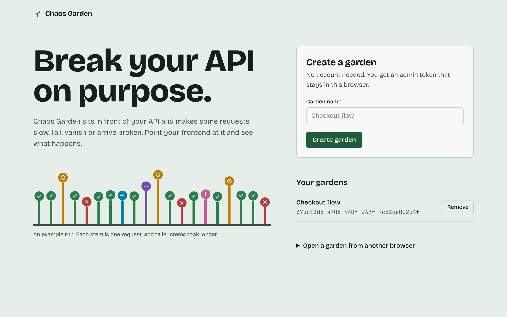
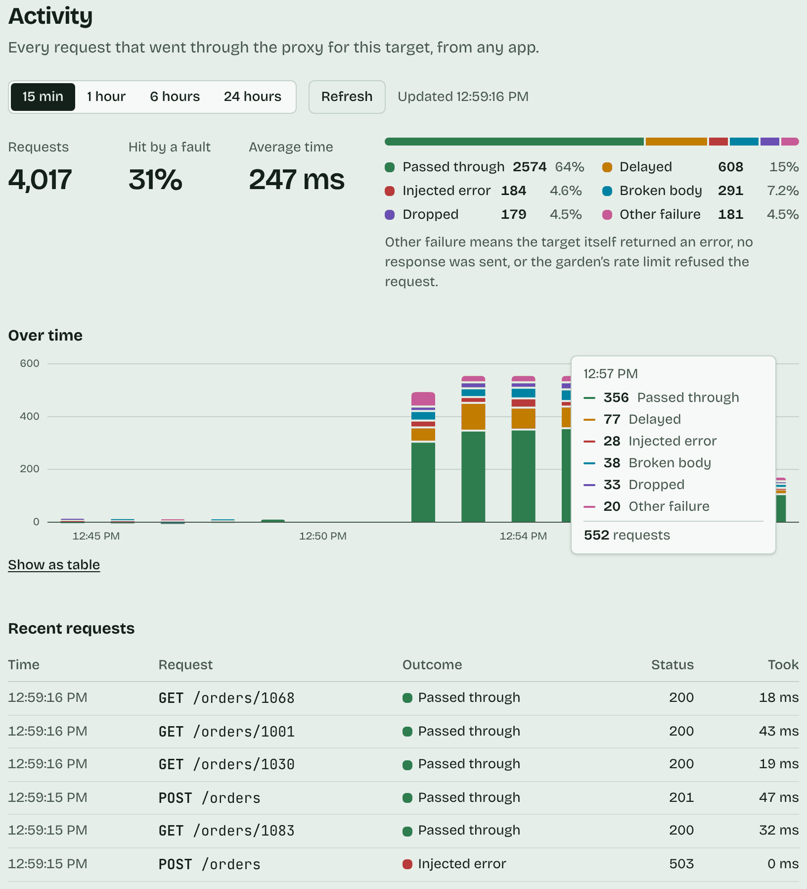
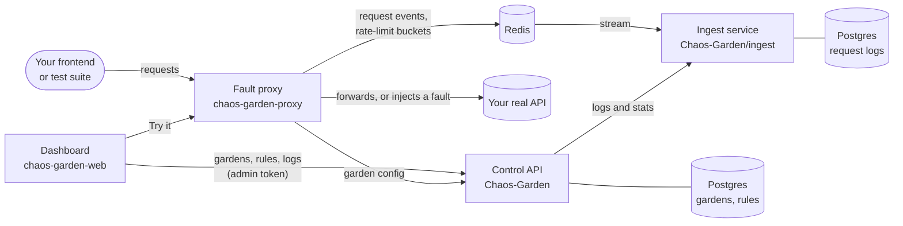
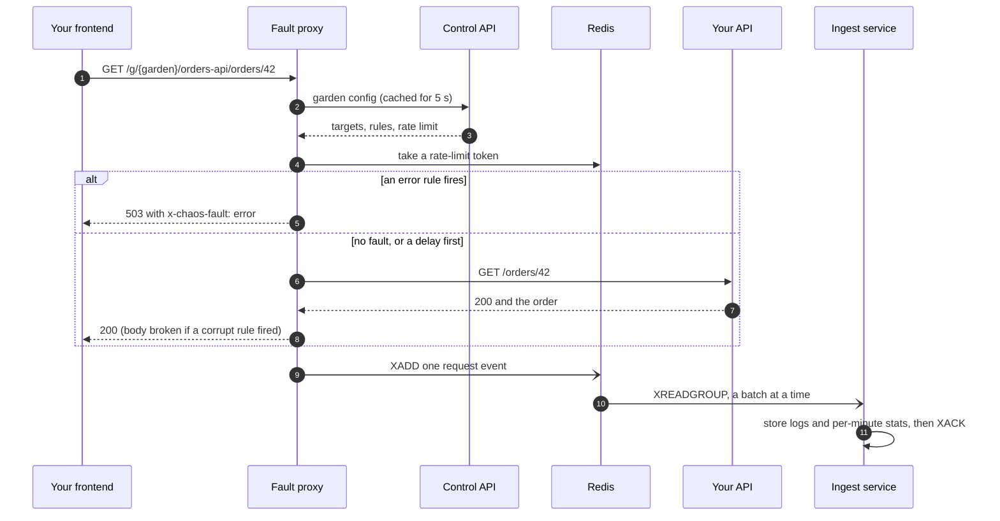
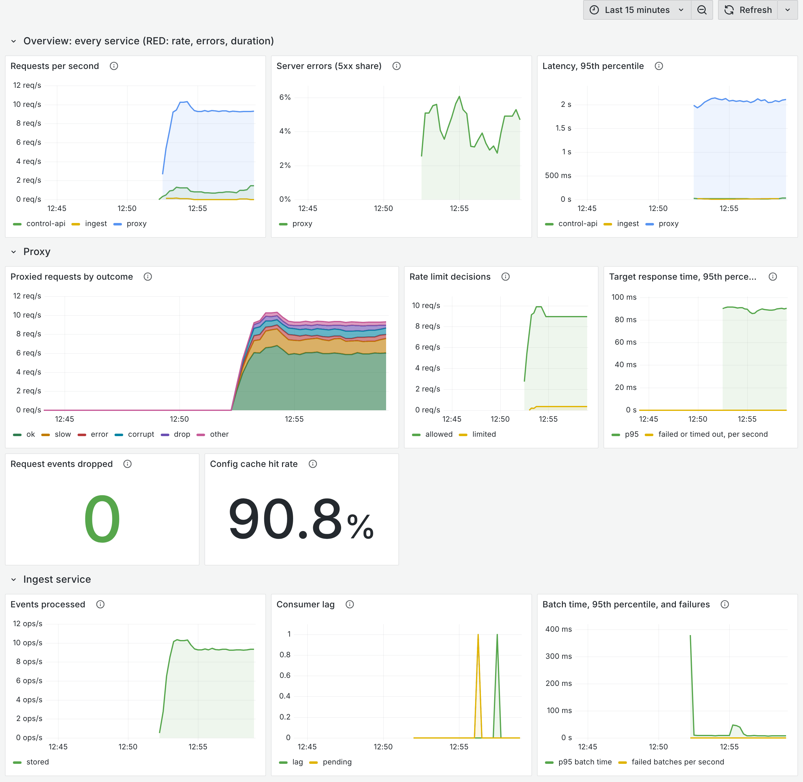
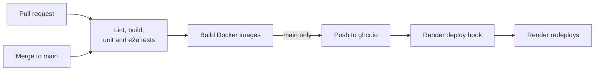

<div align="center">


# Chaos Garden

**Break your API on purpose.** Put Chaos Garden in front of your API, add a few rules, and watch how your frontend copes when requests are slow, fail, vanish or come back broken.

[](https://github.com/georgi4334/Chaos-Garden/actions/workflows/ci.yml)


[](https://render.com/deploy?repo=https://github.com/georgi4334/Chaos-Garden)



</div>

## What it does

1. **Create a garden.** No account: you get an admin token that only works for your garden.
2. **Add a target**, the API you want to test, and get a proxy URL for it.
3. **Add rules:** return a 503 on 20% of `POST /orders`, wait 1.2 s on a quarter of `GET /orders/*`, corrupt the body or drop the connection now and then.
4. **Point your app at the proxy URL** and watch what breaks. Every request is logged, with per-minute stats by outcome.



## The three repositories

| Repository | What it holds | Stack |
|---|---|---|
| **Chaos-Garden** (this one) | Control API, ingest service, event contract, infrastructure, deploy | NestJS, Postgres, Redis |
| [chaos-garden-proxy](https://github.com/georgi4334/chaos-garden-proxy) | The fault proxy, in two interchangeable implementations | NestJS and Go |
| [chaos-garden-web](https://github.com/georgi4334/chaos-garden-web) | The dashboard | Next.js |



Each service owns its data: the control API owns gardens, targets and rules; the ingest service owns request logs and stats. Services call each other with a shared internal key; the browser only ever uses a garden's admin token.

### One request, end to end



## What's in this repository

```
.
├── src/                  Control API (NestJS)
│   ├── gardens/          gardens, admin tokens, per-garden rate limits, creation limit
│   ├── targets/ rules/   targets and fault rules
│   ├── request-logs/     /requests and /stats, read from the ingest service
│   ├── internal/         garden config for the proxy (internal key)
│   ├── observability/    request ids, JSON logs, Prometheus metrics
│   └── database/         Drizzle schema, migrations, runtime migrator
├── test/                 e2e tests
├── ingest/               Ingest service: its own package, database and tests (see ingest/README.md)
├── contracts/            request-event v1: JSON Schema and example events, shared with the proxy
├── infra/                Docker Compose, Prometheus, Grafana and its dashboard generator
├── render.yaml           Render Blueprint for the free deploy
└── DEPLOY.md             step-by-step free deploy: Render, Neon, Vercel
```

## Quick start

You need Node.js 22 and Docker.

```bash
npm install --legacy-peer-deps
cp .env.example .env
npm run db:up          # Postgres, Redis, Prometheus and Grafana in Docker
npm run db:migrate
npm run start:dev      # http://localhost:3000, interactive API docs at /docs
```

The ingest service runs from its own folder:

```bash
cd ingest
npm install --legacy-peer-deps
cp .env.example .env
npm run db:migrate
npm run start:dev      # http://localhost:3200
```

Then start the [proxy](https://github.com/georgi4334/chaos-garden-proxy) (port 3100) and the [dashboard](https://github.com/georgi4334/chaos-garden-web) (port 3001), and open http://localhost:3001. Use the same `INTERNAL_API_KEY` in the control API, ingest service and proxy.

`--legacy-peer-deps` works around an npm crash some environments hit with a plain `npm install`.

### Everything in containers

```bash
npm run stack:up       # pulls the images CI publishes to ghcr.io
npm run stack:build    # or builds them from source (repos cloned side by side)
npm run stack:down
```

This starts Postgres, Redis, the migrations, all four services, Prometheus and Grafana: dashboard on :3001, control API :3000, proxy :3100, ingest :3200, Prometheus :9090, Grafana :3300. It is for local use (shared default internal key, private targets allowed, Grafana without login). To proxy an API running on your machine, use the base URL `http://host.docker.internal:<port>`.

## Control API

**Access without accounts.** `POST /gardens` returns an `adminToken` once; only its SHA-256 hash is stored. Send it as `Authorization: Bearer <adminToken>` on every other call. A token only works for its own garden. `POST /gardens` is limited to 10 gardens per IP address per hour by default.

<details>
<summary><b>Endpoints</b></summary>

| Method | Path | Auth |
|---|---|---|
| POST | `/gardens` | none |
| GET / PATCH / DELETE | `/gardens/:gardenId` (PATCH: `name`, `rateLimitRps`, `rateLimitBurst`) | token |
| GET / POST | `/gardens/:gardenId/targets` | token |
| GET / PATCH / DELETE | `/gardens/:gardenId/targets/:targetId` | token |
| GET / POST | `/gardens/:gardenId/targets/:targetId/rules` | token |
| GET / PATCH / DELETE | `/gardens/:gardenId/targets/:targetId/rules/:ruleId` | token |
| GET | `/gardens/:gardenId/requests?limit=&targetId=&before=` | token |
| GET | `/gardens/:gardenId/stats?minutes=&targetId=` | token |
| GET | `/internal/gardens/:gardenId/config` (for the proxy) | `x-internal-key` |
| GET | `/health`, `/metrics` | none, or `METRICS_TOKEN` for `/metrics` |

Rule types and their `params`: `latency` `{ ms: 0..30000 }`, `error` `{ status: 400..599 }`; `drop` and `corrupt` take none. `probability` is 0 to 1. Each garden's rate limit (default 10 requests per second, bursts of 20; up to 50 and 100) is sent to the proxy with its config.

`/requests` (newest first; page back with `before=<nextBefore>`) and `/stats` (per-minute counts by outcome, last 60 minutes by default) are read from the ingest service. If it is down, those two answer 503 and everything else keeps working. Outcomes: `ok`, `slow`, `error`, `drop`, `corrupt`, `target_error`, `no_response`, `rate_limited`.

</details>

<details>
<summary><b>Configuration</b></summary>

| Variable | Default | Meaning |
|---|---|---|
| `PORT` | `3000` | HTTP port |
| `DATABASE_URL` | none | Postgres for gardens, targets and rules |
| `INTERNAL_API_KEY` | none (internal endpoint rejects all) | shared with the proxy and ingest service |
| `INGEST_URL` | `http://localhost:3200` | the ingest service |
| `CORS_ORIGIN` | `http://localhost:3001` | browser origins allowed to call the API (comma separated) |
| `GARDEN_CREATE_LIMIT` / `GARDEN_CREATE_WINDOW_MS` | `10` / `3600000` | gardens per IP address per window |
| `TRUST_PROXY` | `false` | read client addresses from `X-Forwarded-For` (behind a load balancer) |
| `LOG_FORMAT` | human-readable | `json` for one JSON object per line |
| `METRICS_TOKEN` | none (open) | require a bearer token on `/metrics` |

</details>

## Ingest service

Reads the proxy's request events from a Redis Stream with a consumer group and stores request logs and per-minute stats in its own database. Delivery is at least once and writes are idempotent; events that keep failing go to a dead-letter stream. Details, including its pipeline diagram, are in [ingest/README.md](ingest/README.md).

## Event contract

The event the proxy publishes and the ingest service consumes is defined once, as a JSON Schema with valid and invalid example events, in [contracts/](contracts/README.md). The ingest parser is tested against every example, and the proxy validates every event it publishes in its tests. The proxy repo keeps a copy of the contract, and its CI fails if that copy drifts from this one.

## Observability

Every service gives each request an `x-request-id` (keeping a valid incoming one) and passes it along, so one id follows a request from the browser through the proxy, control API and ingest service, into the stored log. `LOG_FORMAT=json` writes one JSON line per message with that id, and each service exposes Prometheus metrics at `/metrics`: rate, errors and duration by route template, plus each service's own (proxy outcomes and rate-limit decisions, ingest throughput and consumer lag). Labels never contain garden ids or paths.

`npm run db:up` also starts Prometheus (:9090) and Grafana (:3300) with a ready-made dashboard:



The dashboard is generated by `infra/grafana/build_dashboard.py`; change that and rerun it rather than editing the JSON.

## Testing and CI

```bash
npm test                     # unit tests
npm run test:e2e             # e2e tests: needs Postgres running and migrated
node contracts/build-manifest.mjs --check
```



On every pull request and on `main`, CI checks the contract manifest, then runs lint, build, unit tests, migrations and e2e tests for the control API (with Postgres) and the ingest service (with Postgres and Redis), then builds both Docker images. On `main` it pushes `ghcr.io/georgi4334/chaos-garden-control-api` and `chaos-garden-ingest` (tags `main` and `sha-<commit>`) and, if the deploy-hook secrets are set, redeploys them on Render.

## Deploy for free

The Render button above, or [DEPLOY.md](DEPLOY.md) step by step: the backend and the Go proxy on Render's free plan, Postgres on Neon, the dashboard on Vercel. None needs a credit card; the guide lists the free-plan limits (services sleep after 15 minutes idle, among others).

## Roadmap

- Rotate a garden's admin token, and let it be revoked.
- Generate the dashboard's API client from this API's OpenAPI document, so they can't drift.
- Move the garden creation limit to Redis, so it holds across several instances.
- Grafana alert rules for ingest lag, dropped events and error rates.
